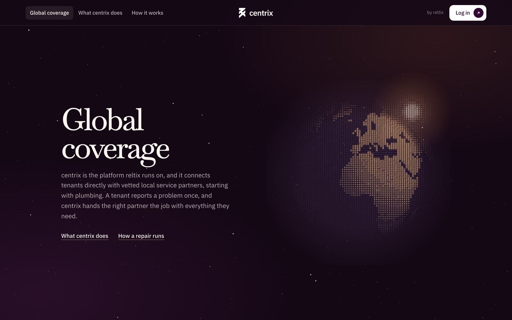
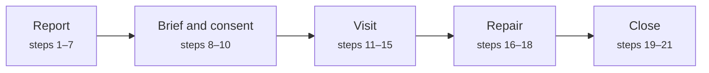
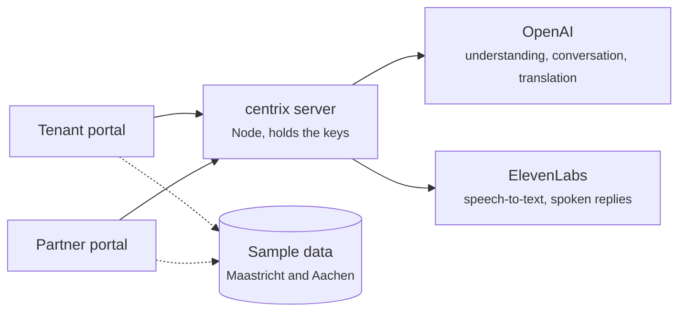
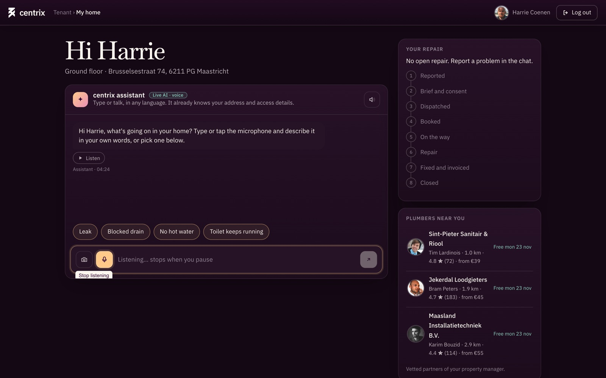
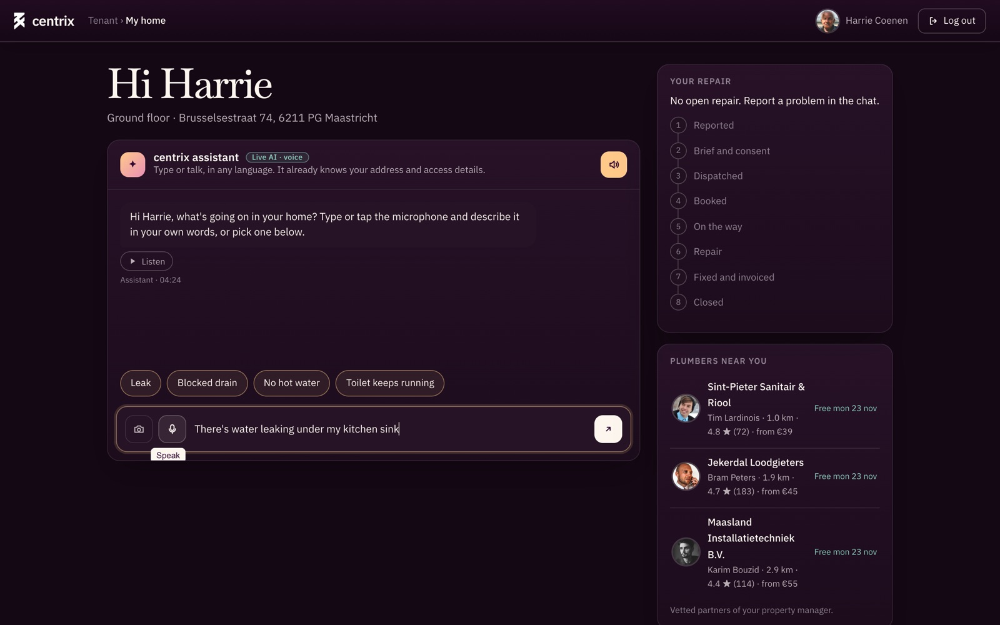
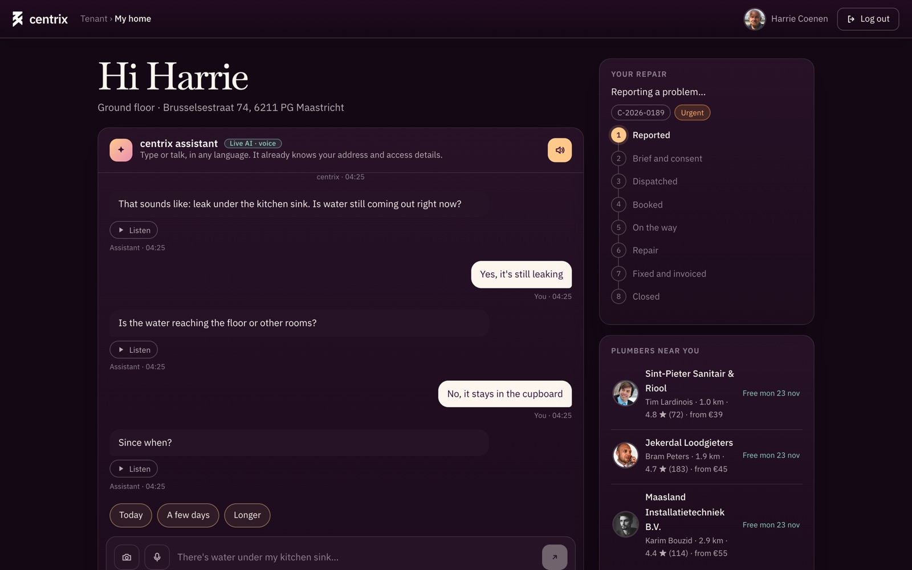
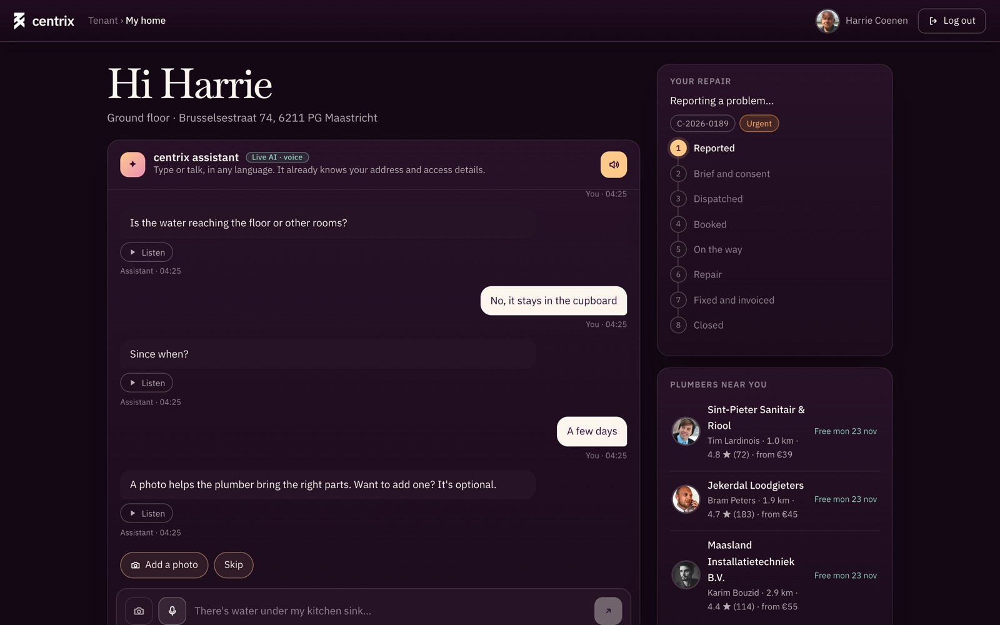
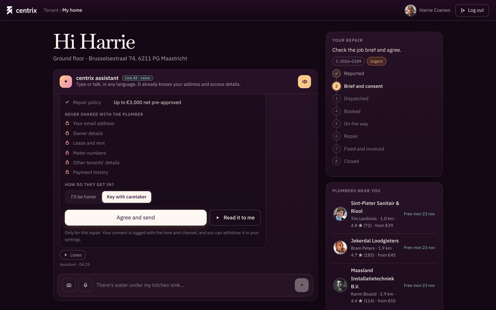
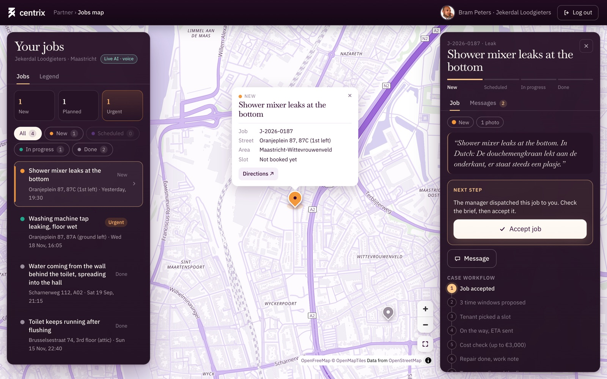
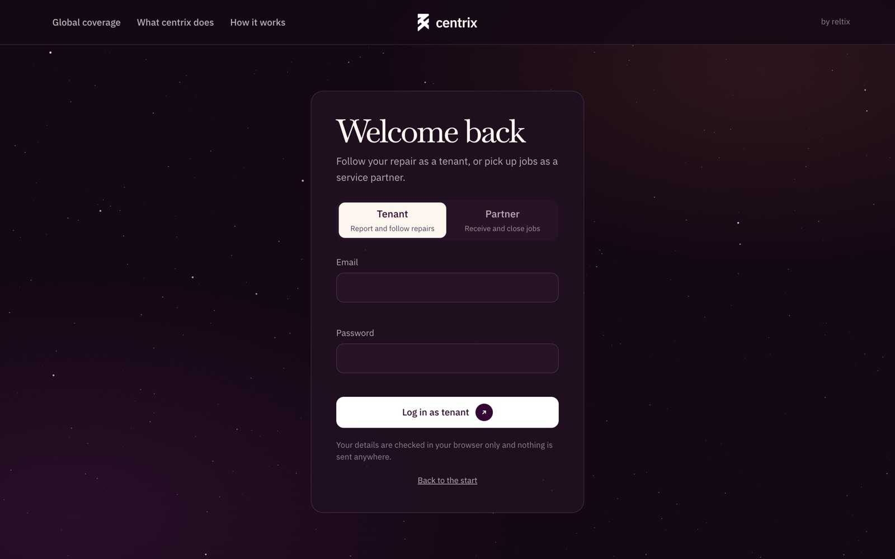

# reltix × centrix: plumbing integration

Our entry for the reltix hackathon challenge **"Plug a Partner into centrix"** (24 hours).

A tenant tells centrix what's wrong, in their own words and by voice if they like, and a vetted plumber takes it from there to a finished, invoiced repair. **The tenant never fills in a form.**



## About the project

### The problem

A property manager sits between owners and tenants on one side and every service provider around the building on the other: plumbers, caretakers, insurers, utilities. Most of that contact still runs by phone, email and paper. One broken heater can take a dozen calls and emails before anyone turns up.

Every service is its own silo with its own forms. Providers don't know when a resident needs them, residents type the same details again and again, and the property manager has no easy way to connect it all.

### reltix and centrix

**reltix** manages properties itself and builds the platform it runs on: **centrix**. In centrix, property managers and AI agents work side by side, and everything about a property lives in one structured record: units, owners, tenants, contracts, cases and every message.

What centrix doesn't have yet is **partners**. Because reltix brings thousands of its own units onto the platform from day one, centrix can become a marketplace: partners get customers without paying to find them, residents get faster service, and every new partner makes the network more useful. That's the gap this project fills.

### The challenge

> Pick one partner and integrate it into centrix. Turn a moment in a property's life into a finished outcome, with zero forms.

We had 24 hours and no access to reltix's systems, so we built our own lightweight stand-in with realistic data. Every solution had to cover four steps:

| Step | What it means | How we do it |
|---|---|---|
| **1. Detect the moment** | When and for whom is the service needed? | The tenant describes the problem in the chat. centrix recognises it as plumbing, detects the language and spots duplicate reports from the same building. |
| **2. Hand over context** | Pre-fill what the partner needs | centrix already knows the address, floor, contact details, shut-off valve and earlier repairs. It only asks what it can't know: since when, how bad, a photo, how to get in. |
| **3. Hold the conversation** | Use the channel that fits best | A chat that works by text or voice, in the tenant's own language. The tenant agrees to what is shared and picks one of the plumber's time windows. |
| **4. Close the loop** | Keep everyone updated until it's done | Live status from booked to on the way to fixed. The work note and invoice are linked to the case and the unit, and a check seven days later updates the home record. |

### Why plumbing

We chose one partner and took it all the way:

- **It happens often, and it's often urgent.** A leak gets worse by the hour and can damage other flats.
- **It's full of back-and-forth today.** Who goes, when is the tenant home, how does the plumber get in, who pays.
- **It has a clear start and end**, from the first report to the invoice.
- **It's a service a partner delivers**, not a product they sell, so it shows the whole hand-off between tenant, manager and partner.

### Who it helps

| | Before | With centrix |
|---|---|---|
| **Tenant** | Calls the office, explains the problem, waits, explains it again to the plumber | Describes it once, by text or voice, in their own language, and follows the repair live |
| **Plumber** | Gets a vague phone message, calls the tenant to plan a visit and ask how to get in | Gets a complete job brief with photos, access and a shut-off valve location, proposes three time windows, and dictates the work note |
| **Property manager** | Relays messages between both sides and chases invoices | Only steps in where a decision is needed: unclear reports, urgent cases and quotes over the €3,000 pre-approved limit |

### How one repair runs

Both portals follow the same [21-step workflow](docs/final-workflow.md), from the first report to the seven-day follow-up:



1. **Report.** The tenant describes the problem. centrix detects the language, classifies it (anything that isn't clearly plumbing goes to the manager), checks for the same leak elsewhere in the building, asks up to three short questions and offers to take a photo. Urgent cases get a call and the shut-off valve location straight away.
2. **Brief and consent.** centrix writes the job brief and shows the tenant exactly what the plumber gets and what is never shared. The tenant agrees, and the consent is logged with the time and channel. The manager dispatches the job.
3. **Visit.** The plumber proposes three time windows, and the tenant picks one or asks for new ones. A reminder goes out the day before, and the tenant sees the plumber's ETA on the day.
4. **Repair.** If the quote is over €3,000, the manager approves it first. The plumber dictates the work note, and the tenant confirms it's fixed.
5. **Close.** The invoice (with 19% VAT) is built from the work note and linked to the case and the unit. The tenant answers two feedback questions, and seven days later centrix checks it's still fixed and updates the home record.

### Privacy and consent

- Only what the job needs is shared with the plumber: name, phone, address, the problem, photos and access.
- Some things are **never shared**: email address, owner details, lease and rent, meter numbers, other tenants' details and payment history.
- Every consent is logged with the time and the channel, only covers this one repair, and can be withdrawn.
- The OpenAI and ElevenLabs keys stay on the server. The browser never sees them.

### Built for the next partner

Plumbing is the first partner, but the setup is generic. Any partner plugs in by describing the same six things:

| | |
|---|---|
| **Services** | What the partner delivers (leaks, blockages, …) |
| **Eligibility** | Which regions, property types and problems |
| **Availability** | How time windows are shared |
| **Placing a job** | Which data centrix sends along |
| **Status updates** | How the partner reports back |
| **Result** | Work report, photos and invoice |

So an electrician, an internet provider or a heating company can connect the same way, without a redesign.

### How it's built



- **Website:** plain HTML, CSS and JavaScript, with no build step.
- **Server:** one small Node file that serves the site and is the only place that talks to OpenAI and ElevenLabs.
- **Data:** a realistic, made-up data set of buildings, units, tenants, plumbers, cases, consents and invoices in Maastricht. It only holds data a property manager would really have ([details](docs/fake-data-structure.md)).
- **Without the server**, the portals still work with built-in rules and the browser's own speech support.

### What's next

- More partners: heating, electrician, internet, energy, insurance.
- More channels: a phone line with an AI voice agent, WhatsApp, and one-click email.
- Picking the right plumber automatically by region, rating and availability.

## A look at the app

### Tenant portal: report a problem by talking

The tenant just describes the problem, by typing or by voice. Tap the microphone and speak: the recording **stops by itself when you pause**, and ElevenLabs turns it into text **in the message field**, so you can check it before you send it.

| Listening | Your words, ready to send |
|---|---|
|  |  |

### Answer the questions by voice

centrix asks up to three short questions. Each has quick-reply buttons, and you can **say the answer instead of tapping**. "It started a couple of days ago" presses **A few days**, "yeah" presses the Yes button, and so on.

| "Since when?" | Answered by voice |
|---|---|
|  |  |

What you can say for each kind of question:

| Question | Button | You can say, for example |
|---|---|---|
| Since when? | **Today** | "today", "this morning", "tonight", "a few hours ago", "it just started", "vandaag", "heute" |
| | **A few days** | "a couple of days", "three days", "since yesterday", "since Monday", "last night", "een paar dagen", "gestern" |
| | **Longer** | "longer", "about two weeks", "more than a week", "10 days", "for months", "quite a while", "al weken" |
| Yes / no | **Yes …** | "yes", "yeah", "yep", "sure", "correct", "ja", "klopt" |
| | **No …** | "no", "nope", "nah", "not yet", "nee", "nein" |
| Rating | Great / Good / OK / Poor | the word itself, e.g. "it was good" |
| Anything else | the button's text | e.g. "Skip", "None of these fit", "I need another time" |

Unclear answers ("I don't know") press nothing: they stay in the message field and go to the assistant as a normal message.

### Job brief and consent

Before anything is shared, the tenant sees exactly what the plumber gets and what is never shared, picks how the plumber gets in, and agrees.



### Partner portal: jobs on a map

The plumber sees their jobs on a map of Maastricht, opens one to read the brief, and follows the case workflow from accepting the job to the invoice.



### Login

Tenants and partners log in on the same page.



## What's in this repo

| Path | What it is |
|---|---|
| [`PROJECT.md`](PROJECT.md) | Full project description: the problem, the challenge, the end-to-end flow and what we build |
| [`docs/final-workflow.md`](docs/final-workflow.md) | The final 21-step workflow for one plumbing case, with the diagram, that the portals follow |
| [`BUILD-PLAN.md`](BUILD-PLAN.md) | Build plan in phases: screens, fake data, automation |
| [`docs/fake-data-structure.md`](docs/fake-data-structure.md) | The fake Maastricht data set: files, fields, links and assumptions |
| [`website/`](website/) | The prototype: a static site in plain HTML, CSS and JavaScript |

### The website

| Page | Purpose |
|---|---|
| `index.html` | Landing page |
| `what-centrix-does.html`, `who-it-helps.html`, `the-difference.html` | Information pages |
| `login.html` | Login for tenants and partners |
| `tenant.html` | Tenant portal: report a problem, give consent, pick a time slot, follow the status |
| `partner.html` | Partner (plumber) portal: incoming jobs, job details, status updates |
| `data/` | Fake sample data: test accounts, tenant data and partner jobs |

### The final workflow (plumbing repair case)

Both portals follow the 21-step final workflow, from the tenant's report to the seven-day follow-up:

| Phase | Tenant portal (`tenant.html`) | Partner portal (`partner.html`) |
|---|---|---|
| Report (1–7) | Type or speak the problem, language detection, classification (or manager review), duplicate check with linked cases, up to 3 follow-up questions, optional photo, urgent path with the shut-off valve | Job brief shows the tenant's answers, language, linked case and shut-off valve |
| Brief and consent (8–10) | Job brief with what is shared and what is never shared, access choice, consent logged with time and channel, manager dispatch | Consent record and "Not shared with you" list; accept the dispatched job |
| Visit (11–15) | Pick one of the plumber's 3 windows or ask for new ones, confirmation, day-before reminder with rebooking, live ETA | Propose 3 windows (typed, suggested or dictated), ETA picker for "I'm on the way" |
| Repair (16–18) | Cost check against the €3,000 pre-approved limit, manager approval above it, work note, "Is it dry now?" | Enter the quote (over €3,000 goes to the manager), dictate the work note, wait for the tenant's confirmation |
| Close (19–21) | Invoice with 19% VAT linked to the case and unit, two feedback questions, seven-day check that updates the home record | Build the invoice from hours and parts, see feedback and the seven-day follow-up |

The manager and the other side of the conversation are played by the dashed buttons in the "Your repair" card (for example "Plumber arrives"). With the server running, the conversation and voice are live (OpenAI and ElevenLabs, see below). Without it, the portals fall back to built-in rules and the browser's own speech support.

The sample data is fake and lives in `website/data/`, and the login only checks it in the browser.

## Running it locally

### With live AI (OpenAI + ElevenLabs)

Needs Node 20 or newer. No packages to install.

```bash
cp .env.example .env   # then put your OpenAI and ElevenLabs keys in .env
npm start              # http://localhost:8780
```

The small server in [`server/server.mjs`](server/server.mjs) serves the website and is the only place that holds the keys. The browser calls `/api/*` on it, never OpenAI or ElevenLabs directly. `.env` is git-ignored: never commit real keys.

What runs live:

| | Tenant portal | Partner portal |
|---|---|---|
| **OpenAI** (`gpt-4.1-mini`, configurable) | Reads the first report: language, plumbing or not, problem type, urgency, and writes 3 follow-up questions in the tenant's language. Answers free questions at every step from the case facts (cost, time, what's shared) and spots intents like "can it be later?" (rebook), "it's leaking again" (reopen) or a new emergency. Translates the portal's own messages and cards into the tenant's language. | Turns a dictated sentence ("tomorrow at ten, Friday two to four…") into 3 time windows, and tidies a dictated work note. |
| **ElevenLabs** | Microphone: record until you pause, then Scribe speech-to-text puts your words in the message field. Spoken answers to quick-reply questions press the matching button. Talking turns on spoken replies (multilingual voice), so it becomes a voice conversation. Every assistant message has a Listen button. | Dictation for time windows and the work note (Scribe), and "Play what the tenant hears" for the spoken ETA. |

The badge next to the assistant's name says **Live AI · voice** when the server and keys are there.

### Without a server (basic mode)

Serve the `website` folder with any static server, for example:

```bash
cd website && python3 -m http.server 8000
```

Then open <http://localhost:8000>. The badge says **Basic mode** and the portals use their built-in rules (keyword classification, fixed questions, browser speech). The maps (MapLibre), the globe (D3) and the fonts load from public CDNs, so you need an internet connection.

### Test accounts

The test accounts are in [`website/data/demo-accounts.js`](website/data/demo-accounts.js). They're fake and protect nothing. Pick the matching role (Tenant or Partner) on the login page.

The Maastricht data set (`website/data/centrix/`, see [`docs/fake-data-structure.md`](docs/fake-data-structure.md)) has a login for every tenant who reported a case and every plumber. The password is the first name + `-demo`, for example `leyla.yilmaz@example.com` / `leyla-demo` (tenant) or `bram.peters@jekerdal.test` / `bram-demo` (partner).

## Tech

- Plain HTML, CSS and JavaScript
- [MapLibre GL](https://maplibre.org/) for the maps in the portals
- [D3](https://d3js.org/) and TopoJSON for the landing page globe
