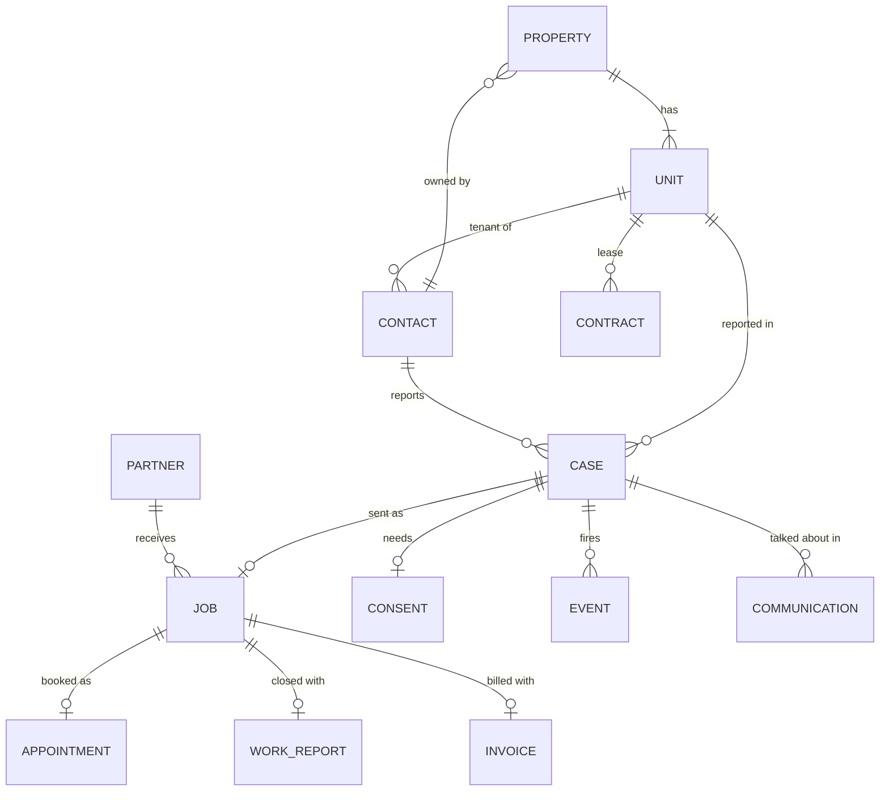

# Fake data structure: what centrix knows

The reltix track description says there is **no reltix dataset or API**. We make our own data "in a JSON file or small database" and decide what centrix holds, as long as it is **realistic** and we **write down what we assumed**. This document describes the fake data set on this branch and why it looks the way it does.

- **Format:** JSON, one file per collection (like tables in a small database), in [`website/data/centrix/`](../website/data/centrix/).
- **Setting:** Maastricht. Real street names, made-up house numbers, people, companies and numbers.
- **Focus:** mostly plumbing. 17 of the 19 cases are plumbing; one heating and one electrical case show what happens when a report is *not* plumbing.
- **Profile pictures:** every tenant who reported a case, and every plumber, has a portrait in [`website/assets/avatars/`](../website/assets/avatars/).
- **Regenerate:** `python3 scripts/generate_fake_data.py website/data/centrix`. The script holds the hand-written cases and derives jobs, events, messages and invoices from them, so the IDs always match.

"Now" in the data is **Saturday 21 November 2026, 09:00** in Maastricht. All times are local time with their UTC offset (`+01:00` in winter, `+02:00` in summer).

---

## 1. Where this comes from

The track description lists what centrix covers. Each item maps to one or more files:

| Track description | Our files |
|---|---|
| Properties & units: address, size, building year, heating type, energy certificate, meters | `properties.json`, `units.json` |
| People: owners, tenants, contact details, move-in and move-out dates | `contacts.json` |
| Contracts: leases, rents, service contracts | `contracts.json` |
| Cases: tenant requests and repairs, with emails and documents | `cases.json` (+ `jobs`, `work_reports`, `invoices`) |
| Communication: every email, call and message, linked to the property | `communications.json` |
| Trigger event from centrix (example payload) | `events.json` |
| Result written back to centrix, with consent (example payload) | `jobs.json`, `consents.json`, `work_reports.json`, `invoices.json` |
| "Show how the partner receives the job and reports back" | `partners.json`, `jobs.json`, `appointments.json` |

We split the track's single "property snapshot" into linked collections. A snapshot for the portals is simply a join: `unit` + its `property` + its current tenant + owner + lease.

---

## 2. How the files link

| Key | Format | Example |
|---|---|---|
| `property_id` | `prop_NN` | `prop_04` |
| `unit_id` | `u_<property>_<number>` | `u_04_0` |
| `contact_id` | `c_oNN` owner, `c_kNN` caretaker, `c_2NN` tenant | `c_213` |
| `partner_id` / `technician_id` | `p_NN` / `t_NN` | `p_01` / `t_02` |
| `case_id` | `C-<year>-<number>` | `C-2026-0181` |
| `job_id`, `consent_id`, `appointment_id`, `report_id`, `invoice_id` | `J-`, `CON-`, `APT-`, `WR-`, `INV-` + the case number | `J-2026-0181` |
| `event_id` / `comm_id` | `ev_NNNN` / `cm_NNNN` | `ev_0042` |
| staff | `pm_NN` (inside `property_manager.json`) | `pm_01` |

Everything about one case shares its number, so `C-2026-0181` → `J-2026-0181` → `INV-2026-0181`.

---

## 3. The collections

### `property_manager.json` (1 object)
The fictional manager **Maaszicht Vastgoedbeheer B.V.**, its two property managers and the **repair policy**:

| Field | Value | Why |
|---|---|---|
| `pre_approved_limit_eur` | 3000 | Same as the final workflow: above this the manager approves the quote first (step 16) |
| `owner_approval_above_eur` | 5000 | Large jobs also need the owner |
| `vat_rate_pct` | 21 | Dutch VAT (the old demo used German 19%) |
| `small_repairs_rule` | Besluit kleine herstellingen | In the Netherlands small repairs (tap washers, a drain the tenant blocked) are paid by the tenant |
| `never_shared_with_partners` | email, owner, lease and rent, meters, other tenants, payment history | The "Not shared with you" list in the job brief |

### `properties.json` (6)
| Field | Meaning |
|---|---|
| `address` | `street`, `number`, `postcode`, `city`, `district` |
| `lat`, `lng` | For the maps |
| `building_year`, `building_type`, `units`, `lift` | |
| `heating` | Individual combi boiler, block heating or heat pump |
| `energy_label` | Dutch energy label `class` + `valid_until` |
| `water_main`, `pipework` | What a plumber needs to know (e.g. lead risers in the 1932 building) |
| `owner_contact_id`, `manager_staff_id`, `caretaker_contact_id`, `key_location` | Who to ask, and where the key is |

| ID | Address | District | Built | Type | Units |
|---|---|---|---|---|---|
| prop_01 | Brusselsestraat 74 | Binnenstad | 1905 | townhouse, 4 apartments | 4 |
| prop_02 | Rechtstraat 58 | Wyck | 1890 | shop + 3 apartments | 3 |
| prop_03 | Scharnerweg 112 | Scharn | 1968 | gallery flat, block heating | 6 |
| prop_04 | Sint Maartenslaan 30 | Wyck | 1932 | mansion, 3 apartments, lead pipes | 3 |
| prop_05 | Oranjeplein 87 | Wittevrouwenveld | 1955 | walk-up flat | 6 |
| prop_06 | Randwycksingel 15 | Randwyck | 2019 | new build, heat pump | 6 |

### `units.json` (28)
`unit_id`, `property_id`, `label`, `floor`, `size_sqm`, `rooms`, `lift`, `boiler` (`model`, `install_year`, `last_service`, or `null` with central heating), `water_shutoff` (where the tenant closes the water: used in the urgent path), `meters` (electricity/gas **EAN** and water meter: never shared with partners) and `history` (the home record, updated when a case closes, final workflow step 21).

### `contacts.json` (33)
One list for everyone, with a `role`: `owner` (4, two of them companies), `caretaker` (1) and `tenant` (28).

| Field | Meaning |
|---|---|
| `first_name`, `last_name`, `name` | |
| `email`, `phone` | Fake (`@example.com`, `+31 6 0000 ....`) |
| `language` | `nl`, `en`, `de`, `pl`, `tr`: drives language detection (step 2) |
| `preferred_channel` | `portal`, `phone`, `whatsapp` or `email`: where centrix reaches them first |
| `avatar` | Path to the profile picture, or `null` |
| `unit_id`, `move_in`, `move_out` | Tenants only |
| `notes` | What a good property manager knows: "81, hard of hearing", "works night shifts, sleeps until 14:00" |
| `owns` / `covers` | Owners' properties / the caretaker's buildings |

The people are a Maastricht mix: Limburg locals, students and PhD candidates, German commuters to Aachen, and Polish and Turkish-speaking tenants.

### `contracts.json` (37)
- `type: "lease"`: `unit_id`, `contact_id`, `start`, `end`, `rent_base_eur`, `service_costs_eur`, `deposit_eur`, `status`
- `type: "management"`: the manager's contract with each owner, including `repair_authority_eur`
- `type: "service"`: boiler maintenance, block-heating cover (**expiring** on 31 Dec: an energy/heating moment) and heat-pump maintenance

### `partners.json` (5)
| Field | Meaning |
|---|---|
| `category`, `services` | What they do (`leak`, `blockage`, `running_toilet`, `no_hot_water`, …) |
| `service_area_postcodes` | 4-digit postcode areas they cover |
| `emergency_24_7`, `response_time_hours` | For picking the right plumber |
| `rates_eur_excl_vat` | `call_out`, `hourly`, `emergency_call_out`, surcharge |
| `rating`, `jobs_done_for_us`, `languages` | |
| `connector` | **How the partner plugs in**: portal, API/webhook or email with one-click links, plus invoice format |
| `technicians` | Name, avatar, phone, languages |
| `availability` | Open 2-hour windows for the next working days |

Three plumbers (Jekerdal Loodgieters, Maasland Installatietechniek, Sint-Pieter Sanitair & Riool), one electrician and one heat-pump company. The three plumbers use three *different* connector channels on purpose: that is the point of the connector spec.

### `cases.json` (19)
The tenant's report and everything centrix decides about it.

| Field | Meaning |
|---|---|
| `reported_by`, `reported_at`, `channel`, `language` | Who, when, how |
| `original_text` | Word for word, in the tenant's language |
| `summary`, `category`, `problem_type`, `urgency` | What centrix made of it (`emergency` / `urgent` / `normal`) |
| `follow_up_answers` | The up-to-3 questions and answers (step 5) |
| `photos` | File names |
| `linked_case_ids` | Duplicate check (step 4) |
| `status` | See below |
| `assigned_partner_id` / `suggested_partner_id`, `job_id`, `consent_id` | |
| `cost_bearer`, `cost_note` | `landlord` or `tenant` (small repairs) |
| `review_reason` | Why it went to a manager |
| `resolution`, `feedback`, `follow_up_7d`, `closed_at` | Closing the loop |
| `timeline` | Every step with `at`, `step`, `by`, `note`: the case history for the centrix view |

**Case statuses**, in the order of the final workflow:

`new` → `manager_review` (not plumbing / unsure) → `awaiting_consent` → `dispatched` → `scheduling` (windows proposed) → `scheduled` → `in_progress` → `quote_approval` (over €3,000) → `awaiting_confirmation` ("is it dry now?") → `invoiced` → `follow_up` (7-day check) → `closed`

**The 19 cases** cover every status, so each screen has something to show:

| Case | Unit | Tenant | Problem | Status | Shows |
|---|---|---|---|---|---|
| C-2026-0141 | Brusselsestraat 74, ground | Harrie Coenen | dripping tap | closed | phone channel, elderly tenant |
| C-2026-0148 | Scharnerweg 112, A02 | Jos Vliegen | burst pipe | closed | **emergency** path at night |
| C-2026-0152 | Brusselsestraat 74, 1st | Elena Rossi | slow shower drain | closed | tenant pays (small repair) |
| C-2026-0157 | Rechtstraat 58, 2nd | Sanne Janssen | leak under sink | closed | same-day repair |
| C-2026-0158 | Rechtstraat 58, 1st | Lukas Schmidt | damp ceiling | closed | **duplicate**, linked to 0157, German |
| C-2026-0163 | Sint Maartenslaan 30, 1st | Julia Kowalska | blocked toilet | closed | Polish, tenant pays |
| C-2026-0170 | Oranjeplein 87B | Sjef Ubachs | no hot water | closed | geyser replaced, €2,128 within the limit |
| C-2026-0174 | Sint Maartenslaan 30, 2nd | Omar Haddad | dripping tap | follow_up | 7-day check pending |
| C-2026-0177 | Brusselsestraat 74, attic | Amara Mensah | running toilet | invoiced | |
| C-2026-0179 | Scharnerweg 112, A01 | Yasmina El Amrani | blocked sink | awaiting_confirmation | |
| C-2026-0180 | Scharnerweg 112, B12 | Femke Habets | cold radiators | manager_review | **heating**, not plumbing |
| C-2026-0181 | Sint Maartenslaan 30, ground | Thomas Wouters | brown water, low pressure | quote_approval | **€3,850 quote** over the limit |
| C-2026-0182 | Randwycksingel 15, 0.2 | Sofia Martins | dead sockets | manager_review | **electrical**, not plumbing |
| C-2026-0183 | Oranjeplein 87A | Leyla Yilmaz | washing-machine tap leak | in_progress | Turkish, voice |
| C-2026-0184 | Rechtstraat 58, 3rd | Mateo Garcia | sewer smell | scheduled | |
| C-2026-0185 | Oranjeplein 87D | Hannah Becker | slow washbasin | scheduled | German, tenant pays |
| C-2026-0186 | Brusselsestraat 74, 2nd | Daan Smeets | no hot water (F28) | scheduling | tenant still has to pick a window |
| C-2026-0187 | Oranjeplein 87C | Lotte Hendriks | leaking shower mixer | awaiting_consent | consent question sent |
| C-2026-0188 | Randwycksingel 15, 0.1 | Anouk Vermeulen | dishwasher leak | new | arrived this morning |

### `jobs.json` (14)
What the **partner** sees. One job per case that has been dispatched.

| Field | Meaning |
|---|---|
| `status` | `offered` → `accepted` → `windows_proposed` → `scheduled` → `in_progress` → `quote_pending_approval` → `done` → `invoiced` → `closed` |
| `brief` | Only the shared data: address, unit, floor, lift, tenant **first name** and phone, language, description (original + translated), answers, photos, access, water shut-off, water main, boiler, building year, pipework, linked cases, cost bearer, limit |
| `withheld` | What the partner never receives |
| `consent_id`, `proposed_windows`, `appointment_id`, `quote`, `work_report_id`, `invoice_id` | |

### `consents.json` (14)
The track says consent must be handled. One record per job, like the track's `consent` payload: `data_shared`, `data_withheld`, `given_at`, `channel`, the exact `wording` the tenant agreed to, and `revoked_at`.

### `appointments.json` (13)
`window_start`, `window_end`, `chosen_by`, `chosen_at`, `access`, `reminder_sent_at` (step 14), `status` (`scheduled`, `in_progress`, `visited`, `completed`).

### `work_reports.json` (9)
`finding`, `work_done`, `labour_hours`, `parts` (name, qty, price), `photos_after`, `dictated`, `tenant_confirmed_at` (step 18) and `home_record_update` (the line that goes into the unit's history).

### `invoices.json` (8)
`lines` (call-out, labour, parts), `subtotal_eur`, `vat_rate_pct` 21, `vat_eur`, `total_eur`, `bill_to` (`property_manager` or `tenant`), `status` (`sent`, `paid`) and the PDF `document`. Linked to the case **and** the unit, as the challenge asks.

### `events.json` (176)
The trigger events, shaped like the track's example: `event`, `occurred_at`, `unit_id`, `contact_id`, `case_id`, `actor`, `data`.

Case events: `case.created`, `case.classified`, `case.linked`, `consent.given`, `job.dispatched`, `job.accepted`, `job.windows_proposed`, `appointment.booked`, `job.on_the_way`, `job.started`, `quote.submitted`, `job.completed`, `tenant.confirmed_fix`, `invoice.issued`, `tenant.feedback`, `case.closed`.

Other moments in a property's life, for the next partner: `tenant.move_in_scheduled` (Ruben Claessens, 1 Dec → internet), `tenant.move_out_scheduled`, `contract.expiring` (block heating) and `boiler.service_due` (a 15-year-old boiler).

### `communications.json` (171)
Every message, linked to case and unit: `at`, `channel` (`portal`, `voice`, `whatsapp`, `email`, `partner_portal`, `api`), `direction`, `from`, `to`, `language`, `text`. Tenant messages are in the tenant's own language.

---

## 4. Assumptions

What we made up, and why we think it is realistic:

1. **A property manager knows** addresses, units, sizes, boilers, meters, leases, contact details, preferred language and channel, who has a key, and where the water shut-off is. It does **not** know the problem details, photos, urgency or when the tenant is home: those are asked in the conversation.
2. **Repair policy:** €3,000 pre-approved (from our final workflow), owner approval above €5,000.
3. **Small repairs** are paid by the tenant, per the Dutch *Besluit kleine herstellingen*. The tenant is told before the job is booked.
4. **VAT 21%**, prices excl. VAT, realistic Maastricht plumber rates (€39–55 call-out, €58–68/hour).
5. **Buildings match their age:** the 1932 building has lead pipes, the 1968 flat has block heating, the 2019 block has a heat pump.
6. **Partners plug in differently:** portal, API or email. The connector spec has to cover all three.
7. **Privacy:** partners only get the tenant's first name and phone, and only after consent. Email, owner, lease, rent and meter numbers are never shared.
8. **Profile pictures** are placeholder portraits from [pravatar.cc](https://pravatar.cc), for the demo only. They are not photos of the people named.
9. **Everything is fake:** people, companies, phone numbers, emails, KvK and EAN numbers. Street names are real; house numbers and postcodes are illustrative.

---

## 5. How the portals use it

[`website/data/centrix-loader.js`](../website/data/centrix-loader.js) reads these JSON files in the browser and builds the data each portal expects, for whoever is logged in:

- **Tenant portal:** the tenant's home (unit, address, floor, access, shut-off, building, repair history), the repair policy, the plumbers that cover their postcode (with distance and free windows), the open cases in the same building (for the duplicate check) and the next case number.
- **Partner portal:** the plumber's jobs with brief, consent, linked case, windows, appointment, quote, work note, invoice, feedback and messages, and the company's rates and free windows.

Log in on `login.html` with any tenant who reported a case or any plumber. The accounts are in [`website/data/demo-accounts.js`](../website/data/demo-accounts.js), and the password is the first name + `-demo` (e.g. `leyla.yilmaz@example.com` / `leyla-demo`, `bram.peters@jekerdal.test` / `bram-demo`). The old Aachen accounts (Lena, Stefan) still use the old data.

The JSON is loaded with `fetch`, so serve the `website` folder (`npm start` or `python3 -m http.server`); opened as a file, the portals fall back to the old data.

**Not yet shown:** the tenant portal only runs a *new* report; it doesn't list the tenant's existing cases yet, and there is no centrix (property manager) view of all cases.
