# Final workflow: plumbing repair case

Project: `chriswartan-jpg/ammands` (reltix challenge "Plug a Partner into centrix")

The final proposal for how one plumbing case runs from start to finish. It uses the **core workflow** (`core-workflow.md`) as its base, takes the best parts of the **other proposal** (`another-proposal-workflow.md`), and adds **new features suggested by the AI**. Every step shows where it comes from and whether it uses **ElevenLabs**.

---

## 1. Visual

The diagram is written in Mermaid. It renders as a picture on GitHub, in Obsidian and in VS Code's Markdown preview.

```mermaid
flowchart TB
    S1["1. Tenant reports the problem<br/><small>Core · ElevenLabs: voice agent takes the report</small>"]
    S2["2. Tenant's language detected<br/><small>AI · ElevenLabs: agent speaks their language</small>"]
    S3["3. Centrix classifies the report<br/><small>Core · n8n + OpenAI or keyword rules</small>"]
    MR["Manager review<br/><small>Core · not plumbing or unsure</small>"]
    S4["4. Duplicate case check<br/><small>AI · same leak? link the cases</small>"]
    S5["5. Tenant answers follow-ups<br/><small>Core · ElevenLabs: agent asks up to 3 aloud</small>"]
    S6["6. Tenant adds a photo<br/><small>Proposal · optional, for context</small>"]
    S7{"7. Urgency check<br/><small>Proposal · from the answers</small>"}
    UP["Urgent path<br/><small>Proposal · ElevenLabs: agent calls the tenant</small>"]
    S8["8. Job brief is prepared<br/><small>Core · report, photo, unit record</small>"]
    S9["9. Tenant gives consent<br/><small>Proposal · ElevenLabs: spoken yes is logged</small>"]
    S10["10. Manager reviews and dispatches<br/><small>Core · priority, approves sharing</small>"]
    S11["11. Plumber proposes 3 time windows<br/><small>Core · ElevenLabs: plumber dictates slots</small>"]
    S12{"12. Tenant picks a slot<br/><small>Core · ElevenLabs: agent reads the 3 options</small>"}
    NF["None fit<br/><small>AI · ElevenLabs: tenant asks for new times</small>"]
    S13["13. Confirmation sent<br/><small>Proposal · to tenant and manager</small>"]
    S14["14. Reminder the day before<br/><small>AI · ElevenLabs: call or message, can rebook</small>"]
    S15["15. Plumber is on the way<br/><small>Proposal · ElevenLabs: spoken ETA, no GPS</small>"]
    S16{"16. On-site cost check<br/><small>AI · within the €3,000 limit?</small>"}
    OQ["Over €3,000<br/><small>AI · manager approves the quote</small>"]
    S17["17. Repair done, work note<br/><small>Core · ElevenLabs: plumber dictates the note</small>"]
    S18["18. Tenant confirms the fix<br/><small>AI · ElevenLabs: agent asks: is it dry now?</small>"]
    S19["19. Invoice sent, linked to the unit<br/><small>Core · made from the work note</small>"]
    S20["20. Tenant gives feedback<br/><small>Proposal · ElevenLabs: two quick questions</small>"]
    S21["21. Seven-day follow-up<br/><small>AI · ElevenLabs: still dry? unit file updated</small>"]

    S1 --> S2 --> S3
    S3 -- Plumbing --> S4
    S3 -- Not plumbing / unsure --> MR
    MR -. Override: continue as plumbing .-> S5
    S4 --> S5 --> S6 --> S7
    S7 -- Not urgent --> S8
    S7 -- Urgent --> UP
    UP --> S8
    S8 --> S9 --> S10 --> S11 --> S12
    S12 -- None fit --> NF
    NF -.-> S11
    S12 -- Slot chosen --> S13
    S13 --> S14 --> S15 --> S16
    S16 -- Within €3,000 --> S17
    S16 -- Over €3,000 --> OQ
    OQ --> S17
    S17 --> S18 --> S19 --> S20 --> S21

    classDef core fill:#F1EFE8,stroke:#5F5E5A,color:#444441
    classDef proposal fill:#E1F5EE,stroke:#0F6E56,color:#085041
    classDef ai fill:#FAECE7,stroke:#993C1D,color:#712B13
    class S1,S3,MR,S5,S8,S10,S11,S12,S17,S19 core
    class S6,S7,UP,S9,S13,S15,S20 proposal
    class S2,S4,NF,S14,S16,OQ,S18,S21 ai
```



**Colours:** grey = from the core workflow · green = from the other proposal · orange = new, added by the AI
**ElevenLabs:** every block that uses ElevenLabs says so in its second line ("ElevenLabs: …"). A block without it doesn't need ElevenLabs.

---

## 2. The diagram as text

```
 1. Tenant reports the problem              [Core]      [ElevenLabs]
              │
              ▼
 2. Tenant's language detected              [AI]        [ElevenLabs]
              │
              ▼
 3. Centrix classifies the report           [Core]
       │                    │
    plumbing         not plumbing / unsure
       │                    ▼
       │             Manager review          [Core]
       │                    │ override: continue as plumbing
       ▼                    │
 4. Duplicate case check    │               [AI]
              │             │
              ▼             │
 5. Tenant answers follow-ups ◄┘            [Core]      [ElevenLabs]
              │
              ▼
 6. Tenant adds a photo (optional)          [Proposal]
              │
              ▼
 7. Urgency check                           [Proposal]
       │                    │
   not urgent             urgent
       │                    ▼
       │             Urgent path             [Proposal]  [ElevenLabs]
       │             (agent calls tenant)
       └─────────┬──────────┘
                 ▼
 8. Job brief is prepared                   [Core]
                 │
                 ▼
 9. Tenant gives consent                    [Proposal]  [ElevenLabs]
                 │
                 ▼
10. Manager reviews and dispatches          [Core]
                 │
                 ▼
11. Plumber proposes 3 time windows ◄───┐   [Core]      [ElevenLabs]
                 │                      │
                 ▼                      │
12. Tenant picks a slot                 │   [Core]      [ElevenLabs]
       │                    │           │
   slot chosen          none fit        │
       │                    ▼           │
       │             None fit ──────────┘   [AI]        [ElevenLabs]
       ▼
13. Confirmation sent                       [Proposal]
                 │
                 ▼
14. Reminder the day before                 [AI]        [ElevenLabs]
                 │
                 ▼
15. Plumber is on the way                   [Proposal]  [ElevenLabs]
                 │
                 ▼
16. On-site cost check                      [AI]
       │                    │
 within €3,000         over €3,000
       │                    ▼
       │             Manager approves quote  [AI]
       └─────────┬──────────┘
                 ▼
17. Repair done, work note                  [Core]      [ElevenLabs]
                 │
                 ▼
18. Tenant confirms the fix                 [AI]        [ElevenLabs]
                 │
                 ▼
19. Invoice sent, linked to the unit        [Core]
                 │
                 ▼
20. Tenant gives feedback                   [Proposal]  [ElevenLabs]
                 │
                 ▼
21. Seven-day follow-up → case closed       [AI]        [ElevenLabs]
```

| Step | What happens | Who | Source | ElevenLabs |
|---|---|---|---|---|
| 1 | The tenant reports the problem by text or voice. No form. | Tenant | Core | **Live now:** voice agent takes the report |
| 2 | Centrix detects the tenant's language and keeps talking in it. | Centrix | AI | Proposed: multilingual voice agent |
| 3 | Centrix classifies the report: plumbing, not plumbing or unsure. | Centrix | Core | No |
| 3b | Not plumbing or unsure: the manager handles it, or overrides it to plumbing. | Manager | Core | No |
| 4 | Centrix checks whether the same leak was already reported (for example by the flat below) and links the cases. | Centrix | AI | No |
| 5 | The tenant answers up to 3 one-tap follow-up questions. | Tenant | Core | **Live now:** agent asks the questions aloud |
| 6 | The tenant can add a photo (optional). | Tenant | Proposal | No |
| 7 | Centrix decides from the answers whether the problem is urgent. | Centrix | Proposal | No |
| 7b | Urgent: the voice agent calls the tenant, explains where the shut-off valve is, and alerts the manager. | Centrix | Proposal | Proposed: outbound call by the voice agent |
| 8 | Centrix builds the job brief from the report, answers, photo and unit record. | Centrix | Core | No |
| 9 | The tenant hears or reads what the plumber will receive, and agrees. The consent is logged with time and channel. | Tenant | Proposal | Proposed: agent reads it out, spoken yes is logged |
| 10 | The manager checks the brief, sets priority and dispatches. | Manager | Core | No |
| 11 | The plumber proposes 3 time windows. | Plumber | Core | Proposed: plumber dictates the slots (speech-to-text) |
| 12 | The tenant picks one slot. | Tenant | Core | Proposed: agent reads the 3 options, tenant says one |
| 12b | None of the 3 fit: the tenant asks for new times and step 11 repeats. | Tenant | AI | Proposed: rebook by voice |
| 13 | The tenant and the manager get a confirmation with who the plumber is. | Centrix | Proposal | No |
| 14 | The day before, the tenant gets a reminder and can still rebook. | Centrix | AI | Proposed: voice call or voice message |
| 15 | The plumber taps "on the way" and the tenant hears the ETA. | Plumber → tenant | Proposal (changed: ETA instead of live GPS) | Proposed: spoken ETA message |
| 16 | On site, the plumber checks whether the repair stays within the €3,000 pre-approved limit. | Plumber | AI | No |
| 16b | Over €3,000: the manager approves the quote before the repair starts. | Manager | AI | No |
| 17 | The plumber marks the repair done and adds a work note. | Plumber | Core | Proposed: plumber dictates the note (speech-to-text) |
| 18 | The tenant confirms that the problem is really fixed. | Tenant | AI | Proposed: agent asks "is it dry now?" |
| 19 | The invoice is made from the work note and linked to the case and the unit. | Plumber → Centrix | Core | No |
| 20 | The tenant shares how they experienced the service. | Tenant | Proposal | Proposed: two quick spoken questions |
| 21 | After seven days Centrix checks whether the problem stayed fixed and updates the unit record. The case closes. | Centrix | AI | Proposed: short voice check |

**Count:** 9 main steps from the core, 6 from the proposal, 6 new from the AI, plus 4 side branches. ElevenLabs is used in 13 blocks: 2 live today (steps 1 and 5), 11 proposed.

---

## 3. How the workflow works

### Reading the diagram

The workflow runs from top to bottom. Each box is one step.

- The **colour** shows where the step comes from: grey = core workflow, green = the other proposal, orange = a new feature added by the AI.
- The **second line** of each box starts with the source and, if the step uses ElevenLabs, says how ("ElevenLabs: …").
- The **diamond** shapes (steps 7, 12 and 16) are decisions where the flow splits.
- **Dashed arrows** are the two ways back: the manager's override (from manager review to step 5) and the rebooking loop (from "None fit" back to step 11).

### Phase 1: the report (steps 1 to 7)

1. **Tenant reports the problem** *(core, ElevenLabs live)*. The tenant types or speaks the problem, for example "water is leaking from the pipe under my kitchen sink". The ElevenLabs voice agent already does this in the demo.
2. **Tenant's language detected** *(AI, ElevenLabs)*. If the tenant speaks Turkish, Polish or Arabic, the voice agent answers in that language. The plumber still gets the brief in German. **Why added:** many tenants don't speak German or English well, and they are exactly the ones who struggle with forms and phone calls today.
3. **Centrix classifies the report** *(core)*. AI via n8n, or the built-in keyword rules if n8n is offline. Not plumbing or unsure goes to **manager review**. The manager can override it back to plumbing, which continues at step 5.
4. **Duplicate case check** *(AI)*. Centrix checks whether there is already an open case for the same leak, for example from the flat below. If so, it links the cases. **Why added:** one leak often shows up in two flats. Linking them saves a second plumber trip and a second invoice.
5. **Tenant answers follow-ups** *(core, ElevenLabs live)*. Up to 3 one-tap questions. With voice, the agent asks them aloud.
6. **Tenant adds a photo** *(proposal)*. Optional, so a case never gets stuck here. It goes into the job brief.
7. **Urgency check** *(proposal)*. Centrix uses the answers (for example "water is still leaking") to decide whether it's urgent.
   - **Urgent path** *(proposal, ElevenLabs)*. The voice agent calls the tenant, explains where the water shut-off is (from the unit record), and alerts the manager. Then the case continues at step 8. This replaces the proposal's phone call by a person.

### Phase 2: brief, consent and dispatch (steps 8 to 10)

8. **Job brief is prepared** *(core)*. Report + answers + photo + unit record + repair policy. It also lists what is deliberately withheld (tenant email, owner details, lease, meter numbers).
9. **Tenant gives consent** *(proposal, ElevenLabs)*. The tenant sees, or hears from the agent, exactly what the plumber will receive and agrees. The time, channel and wording of the consent are logged. This answers the proposal's open point and the challenge's consent requirement.
10. **Manager reviews and dispatches** *(core)*. Only now does the plumber receive any data.

### Phase 3: planning the visit (steps 11 to 15)

11. **Plumber proposes 3 time windows** *(core, ElevenLabs)*. The plumber can dictate them instead of typing.
12. **Tenant picks a slot** *(core, ElevenLabs)*. The agent reads the three options and the tenant says which one.
    - **None fit** *(AI, ElevenLabs)*. The tenant asks for new times and the plumber proposes again (back to step 11). **Why added:** this answers the proposal's open point "what if no time suits?".
13. **Confirmation sent** *(proposal)*. Tenant and manager both get the appointment and who the plumber is.
14. **Reminder the day before** *(AI, ElevenLabs)*. A short voice call or voice message with an option to rebook. **Why added:** a tenant who isn't home is the most common reason a repair visit fails.
15. **Plumber is on the way** *(proposal, ElevenLabs)*. The plumber taps one button and the tenant hears the ETA. This is a simpler version of the proposal's live GPS tracking.

### Phase 4: the repair (steps 16 to 18)

16. **On-site cost check** *(AI)*. Before starting, the plumber checks whether the repair stays within the €3,000 pre-approved limit.
    - **Over €3,000** *(AI)*. The manager approves the quote first. **Why added:** the core only has a pre-approval rule as text (€250 there), with no step that enforces it. This workflow sets the pre-approved limit at €3,000 and checks it on site.
17. **Repair done, work note** *(core, ElevenLabs)*. The plumber dictates what was found and fixed. Dirty hands, so voice is easier than typing.
18. **Tenant confirms the fix** *(AI, ElevenLabs)*. The agent asks the tenant "is it dry now?". **Why added:** in the core the plumber marks the job done alone. With the tenant's confirmation, the invoice only goes out for a repair that actually worked.

### Phase 5: closing the loop (steps 19 to 21)

19. **Invoice sent, linked to the unit** *(core)*. Made automatically from the work note (call-out, labour, parts, 19% VAT), linked to the case and the unit.
20. **Tenant gives feedback** *(proposal, ElevenLabs)*. Two quick spoken or tapped questions.
21. **Seven-day follow-up** *(AI, ElevenLabs)*. A week later the agent checks whether the problem stayed fixed. The unit record is updated (for example "pipe under kitchen sink replaced, Nov 2026"), so the next brief for this flat is better. Then the case closes. **Why added:** it catches repairs that fail again, and it builds up the flat's history.

### What was removed from the other proposal, and why

| Removed | Why | What replaces it |
|---|---|---|
| Phone call channel run by a person | Someone would have to staff a phone line | The ElevenLabs voice agent and the urgent path (7b) |
| Tenant shares availability first | Means more back-and-forth, and the core app already works the other way | The plumber proposes 3 times, the tenant picks one (steps 11–12) |
| Next-plumber loop | The demo has only one partner (Klarfluss Sanitär), so it can't be shown | The "None fit" rebooking loop (12b) |
| Live GPS tracking | Too much to build for a hackathon | A one-tap "on the way" with a spoken ETA (step 15) |

### How ElevenLabs is used

| ElevenLabs product | Steps |
|---|---|
| Voice agent (already in the demo) | 1, 2, 5, 9, 12, 12b, 18, 20, 21 |
| Voice agent making phone calls | 7b (urgent path), 14 (reminder) |
| Speech-to-text (Scribe) | 11 (time windows), 17 (work note) |
| Text-to-speech | 15 (spoken ETA) |

Only steps 1 and 5 are live in the demo today. The other uses are proposals that haven't been built or tested yet.

### How this fits the challenge

| Challenge step | Covered by |
|---|---|
| Detect the moment | Steps 1–4: report, language, classification, duplicate check |
| Hand over context | Steps 5–9: follow-ups, photo, urgency, job brief, consent |
| Hold the conversation | Steps 10–15: dispatch, time windows, booking, confirmation, reminder, ETA |
| Close the loop | Steps 16–21: cost check, work note, tenant confirmation, invoice, feedback, follow-up |

### For the hackathon demo

At 21 steps, this is the full vision and too much to show live. The suggestion is to present the whole workflow as the vision, and in the live demo add only three new steps to what already works: the **duplicate case check (4)**, the **on-site cost check (16)** and the **tenant confirms the fix (18)**.
